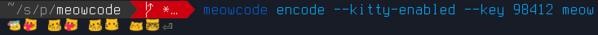

# Meowcode




Convert boring text to streams of :meow: for slack messages and such meowfoolery.

As meme demands, blazingly fast.

Simple meowcryption included so meow sequences look random and a simple key can be provided.

to encode text:

```shell
meowcode --key 12345 --encode something
meowcode --key 12345 --decode ":meow-nwn: :meow-pat: :meow-melt: :meow-nwn: :meow-nwn: :meow-coffee:"
```

You can also pipe in stdin and print out emoji's line by line:

```sh
cat /dev/urandom | meowcode stdio-encoder --key 12345 
```

Kitty rendering of emoji's is supported with `--kitty-enabled` but is only practical for short sequences.


## Building

Rust stable channel, cargo build, :meow-smug:.

Tests? Cat's don not test.

## Emoji Assets

There's .png's of the emoji's in `assets/` the file names need to match `NYBBLE_TO_MEOW` in `src/consts.rs`.

## License

WTFPL what else
