### 

I found a tool without source code and it seems to encrypt text to slack style emojis.

For example:

```
$ ./meowcode encode --boring "Some example clear text"
:meow-ok: :meow-yikes: :meow-cry: :meow-pat: :meow-smart: :meow-ok: :meow-nwn: :meow-love: :meow-coffee: :meow-sweat: :meow-coffee: :meow-sob: :meow-yikes: :meow-coffee: :meow-pat: :meow-sweat: :meow-sob: :meow-yikes: :meow-nwn: :meow-coffee: :meow-sad: :meow-nwn: :meow-melt: :meow-smart: :meow-bread: :meow-sweat: :meow-nwn: :meow-sweat: :meow-coffee: :meow-love: :meow: :meow-sob: :meow-sweat: :meow-shocked: :meow-sob: :meow-smart: :meow-sad: :meow-pat: :meow-melt: :meow-bread: :meow-cry: :meow-sad: :meow-shocked: :meow-sad: :meow-coffee: :meow-shocked:
```

Can you figure out what the encryption scheme is?

Looking at the ratio of input characters to output tokens is the key:

- Input "Some example clear text" = 23 characters
- Output = 46 `:meow-*:` tokens
- **46 ÷ 23 = exactly 2 tokens per character**

That strongly suggests a **nibble/hex encoding**: each byte of the input is split into two 4-bit nibbles, and each nibble (0–15) is mapped to one of a 16-symbol "meow" alphabet instead of the usual `0-9a-f`.

Checking the distinct emoji suffixes used in your sample:
```
ok, yikes, cry, pat, smart, nwn, love, coffee, sweat, sob, sad, melt, bread, shocked, (plain "meow")
```
That's **15 distinct suffixes + the bare `:meow:`** = **16 total symbols** — exactly matching a hex alphabet (0–F).

So the scheme is almost certainly:

1. Take the UTF-8 bytes of the input text.
2. For each byte, split into high nibble and low nibble (standard hex encoding).
3. Map each nibble value (0–15) to a fixed emoji name via a lookup table, e.g.:
   ```
   0 -> meow
   1 -> meow-ok
   2 -> meow-yikes
   3 -> meow-cry
   4 -> meow-pat
   5 -> meow-smart
   6 -> meow-nwn
   7 -> meow-love
   8 -> meow-coffee
   9 -> meow-sweat
   A -> meow-sob
   B -> meow-yikes (reuse? or sad)
   ...
   ```
   (exact mapping would need to be recovered by encoding known bytes, e.g. encode "A", "B", "0", etc., one at a time to build the table)
4. Output each nibble's emoji, space-separated, high nibble first then low nibble — essentially **hex encoding with a custom 16-symbol emoji alphabet** (like how Base16/hex works, just reskinned).

To fully reverse it: run `./meowcode encode` on single known bytes (e.g. each hex digit's ASCII representation, or feed in `\x00`, `\x01`, ... `\x0f` bytes) to build the nibble→emoji table, then decode other ciphertexts by reversing the lookup and reassembling bytes.

The `--boring` flag likely just means "no extra flourishes/randomization," i.e., a deterministic 1:1 mapping (as opposed to some default mode that might add decoys or randomize which emoji represents a given nibble, for extra obfuscation/fun).

### 
If i encode the whole alphabet, can you then create the mapping table? Assuming i only care about letters.

Yes — that would work well. Here's the plan:

1. **Encode the lowercase alphabet** (and uppercase too, if you want full coverage):
   ```
   ./meowcode encode --boring "abcdefghijklmnopqrstuvwxyz"
   ```
   This gives you 26 known bytes, each with a known ASCII hex value:
   - `a` = 0x61 → nibbles `6`, `1`
   - `b` = 0x62 → nibbles `6`, `2`
   - `c` = 0x63 → nibbles `6`, `3`
   - ... up to `z` = 0x7A → nibbles `7`, `A`

2. **Line up each letter's two emoji tokens** with its known nibble pair. Since consecutive lowercase letters increment by 1 in the low nibble (and roll over the high nibble every 16 letters), you'll quickly see which emoji corresponds to each hex digit 0–F.

   For example, comparing `a` (0x61) vs `b` (0x62): the first emoji token should be identical (both have high nibble `6`), and only the second token changes (nibble `1`→`2`). That confirms both the high-nibble and low-nibble emoji identities.

3. Repeat similarly for uppercase (`A`=0x41 ... `Z`=0x5A) to cross-check / fill in any nibble values not seen in lowercase (since lowercase only covers nibbles 6–7 for high nibble, and 1–A for low nibble — you’d miss some digits like 0,B–F unless you include uppercase or digits too).

4. Once you have all 16 emoji ↔ nibble pairs, build a simple lookup table (dictionary) either direction:
   ```
   emoji_to_nibble = { ":meow:": 0x0, ":meow-ok:": 0x1, ... }
   nibble_to_emoji = { 0x0: ":meow:", 0x1: ":meow-ok:", ... }
   ```

5. With that table, you can decode arbitrary meowcode output back to bytes (hex → ASCII), as long as it only used letters/bytes within the nibble range you captured.

**Caveat:** if you only care about letters, lowercase alone encodes nibbles `{1,2,3,4,5,6,7,8,9,A}` for low nibble and `{6,7}` for high nibble — missing `0,B,C,D,E,F`. So to get a *complete* table, also encode something like `"0123456789"` or `"ABCDEFGHIJKLMNOPQRSTUVWXYZ"`/other ASCII ranges to pin down the missing nibble values.

If you paste me the actual encoded output for the alphabet string, I can build the mapping table for you directly.

### 
This results in:

```
./meowcode encode --boring "abcdefghijklmnopqrstuvwxyz"
:meow-smart: :meow: :meow-cry: :meow-sob: :meow-smart: :meow-bread: :meow-nwn: :meow: :meow-sweat: :meow-pat: :meow-coffee: :meow: :meow-sob: :meow: :meow-pat: :meow-yikes: :meow-sob: :meow-cry: :meow-shocked: :meow-sad: :meow-sad: :meow-sweat: :meow-melt: :meow: :meow: :meow-cry: :meow-nwn: :meow-cry: :meow-coffee: :meow-yikes: :meow-love: :meow-cry: :meow-ok: :meow-shocked: :meow-sob: :meow-smart: :meow: :meow-shocked: :meow-melt: :meow-bread: :meow-melt: :meow-sad: :meow-shocked: :meow-sweat: :meow-coffee: :meow-pat: :meow-melt: :meow-sob: :meow-pat: :meow-sob: :meow-coffee: :meow-nwn:
```


Good data! Let's check whether this is really a **simple static nibble→emoji table** (like Base16) or something more complex.

Each letter `a`–`z` has known ASCII hex: `a`=0x61, `b`=0x62, ... `o`=0x6F, `p`=0x70, ... `z`=0x7A. So the **high nibble should be `6` for a–o and `7` for p–z**, over and over.

If this were a static substitution table, the token for nibble value `6` should be the **same emoji every single time**. Let's check — pulling out just the high-nibble tokens for a–o:

```
a: smart
b: cry
c: smart
d: nwn
e: sweat
f: coffee
g: sob
h: pat
i: sob
j: shocked
k: sad
l: melt
m: meow
n: nwn
o: coffee
```

These are all supposed to represent the **same nibble value (`6`)**, but they're wildly different emojis. A static lookup table would give the same emoji every time for the same nibble.

**This rules out a simple fixed substitution/hex-alphabet scheme.**

This strongly suggests the tool is doing **actual encryption** (not just encoding) — e.g.:
- A stream cipher (XOR with a keystream that changes per position), or
- A block cipher in a mode like CFB/CTR, or
- Possibly a random IV/nonce mixed in per invocation (meaning **the same input might even produce different output on each run** — worth testing!).

**Suggested next steps to pin this down:**
1. Run the exact same command twice:
   ```
   ./meowcode encode --boring "aaaaaaaa"
   ```
   twice in a row. If the output differs between runs → there's a random IV/nonce/key (true encryption, not deterministic encoding).
2. If output is **identical** across runs, it's deterministic — try:
   - Encoding a long run of a single repeated character (`"aaaaaaaaaaaaaaaa"`) to look for a repeating keystream period (classic stream-cipher XOR tell).
   - Check if there's a `decode` subcommand or a `--key`/`--seed` flag — run `./meowcode --help` or `./meowcode encode --help`.

Can you try running the same input twice and also check `--help` output? That'll tell us whether we're dealing with deterministic obfuscation vs. real keyed encryption.

### 

Run 1:

```
:meow-smart: :meow: :meow-cry: :meow: :meow-smart: :meow-cry: :meow-nwn: :meow-sad: :meow-sweat: :meow-ok: :meow-coffee: :meow-melt: :meow-sob: :meow-cry: :meow-pat: :meow-sweat:
```

Run 2:

```
:meow-smart: :meow: :meow-cry: :meow: :meow-smart: :meow-cry: :meow-nwn: :meow-sad: :meow-sweat: :meow-ok: :meow-coffee: :meow-melt: :meow-sob: :meow-cry: :meow-pat: :meow-sweat:
```


Deterministic — same input produces identical output both runs. Good, that rules out random IV/nonce. But combined with the alphabet data, we found something important:

**The same character `a` encodes differently depending on position!**

Looking at `"aaaaaaaa"` (8 `a`'s, all = `0x61`, nibbles `6,1`):

```
pos:  1      2     3    4     5      6    7    8     9      10   11      12   13   14    15   16
tok: smart  meow  cry  meow smart  cry  nwn  sad  sweat   ok  coffee  melt sob  cry  pat  sweat
```

If this were a static nibble→emoji table, we'd expect the exact same pair `(X, Y)` repeated 8 times (once per `a`). Instead every pair is different. That rules out a simple substitution/hex-alphabet encoding — **this confirms it's a real stream cipher**: each byte (or nibble) is XORed with a keystream that advances by position, then the result is encoded via the (likely static) nibble→emoji table.

**This is good news for cracking it**, because:
- It's deterministic (no random nonce) ⇒ same key/keystream every run.
- It's positional, not content-dependent ⇒ classic XOR-with-keystream (think RC4-style or simple repeating-key XOR).

**To fully break this, next steps:**

1. **Recover the nibble↔emoji table.** Since it's likely a fixed set of 16 symbols mapped to hex digits 0-F, we need an input where we know the *plaintext nibble* at each position — but since keystream also varies by position, table and keystream are entangled. We can solve this if we have two known plaintexts of the same length (so same keystream applied) — XOR their known nibble values and compare to XOR'd emoji-pair output indices. That lets us solve for keystream independent of the table's actual symbol meanings (just need consistent emoji→index assignment, even if we don't know which index means what hex digit).

2. **Best next test:** encode a long run of **all zero-equivalent / simple incrementing known text** of the same length, e.g.:
   ```
   ./meowcode encode --boring "aaaaaaaaaaaaaaaaaaaaaaaaaaaaaaaa"   (32 a's)
   ./meowcode encode --boring "bbbbbbbbbbbbbbbbbbbbbbbbbbbbbbbb"   (32 b's, same length!)
   ```
   Since `a`=0x61 and `b`=0x62 differ only in the low nibble (1 vs 2), comparing outputs position-by-position will isolate the keystream's effect on low nibbles, and reveal whether keystream repeats with a short period (likely, if it's a repeating-key XOR rather than a full stream cipher like RC4).

Can you run those two same-length strings (`a`×32 and `b`×32) so we can look for a repeating keystream period?

### 

32 a's:

```
:meow-smart: :meow: :meow-cry: :meow: :meow-smart: :meow-cry: :meow-nwn: :meow-sad: :meow-sweat: :meow-ok: :meow-coffee: :meow-melt: :meow-sob: :meow-cry: :meow-pat: :meow-sweat: :meow-sob: :meow-pat: :meow-shocked: :meow-pat: :meow-sad: :meow-love: :meow-melt: :meow-shocked: :meow: :meow-ok: :meow-nwn: :meow-smart: :meow-coffee: :meow-nwn: :meow: :meow-melt: :meow-sweat: :meow-shocked: :meow-yikes: :meow-ok: :meow-love: :meow-coffee: :meow-cry: :meow-love: :meow-cry: :meow-love: :meow-nwn: :meow-nwn: :meow-pat: :meow-nerd: :meow-cry: :meow-ok: :meow-coffee: :meow-sweat: :meow-pat: :meow-melt: :meow: :meow-ok: :meow-ok: :meow-sad: :meow: :meow: :meow-smart: :meow-sob: :meow-nwn: :meow-sob: :meow-sad: :meow-bread:
```

32 b's:

```
:meow-smart: :meow-sob: :meow-cry: :meow-sob: :meow-smart: :meow-sad: :meow-nwn: :meow-cry: :meow-sweat: :meow-smart: :meow-coffee: :meow-bread: :meow-sob: :meow-sad: :meow-pat: :meow-nerd: :meow-sob: :meow-shocked: :meow-shocked: :meow-shocked: :meow-sad: :meow-yikes: :meow-melt: :meow-pat: :meow: :meow-smart: :meow-nwn: :meow-ok: :meow-coffee: :meow-coffee: :meow: :meow-bread: :meow-sweat: :meow-pat: :meow-yikes: :meow-smart: :meow-love: :meow-nwn: :meow-cry: :meow-yikes: :meow-cry: :meow-yikes: :meow-nwn: :meow-coffee: :meow-pat: :meow-sweat: :meow-cry: :meow-smart: :meow-coffee: :meow-nerd: :meow-pat: :meow-bread: :meow: :meow-smart: :meow-ok: :meow-cry: :meow: :meow-sob: :meow-smart: :meow: :meow-nwn: :meow: :meow-sad: :meow-melt:
```


Excellent, this is very revealing. Let's analyze both findings:

## 1. Confirmed: static table + positional keystream (not content-dependent)

Comparing **odd positions** (high nibble, constant `0x6` for both `a` and `b`) between the two runs — **all 32 match exactly**:

```
pos: 1  3  5  7  9 11 13 15 17 19 21 23 25 27 29 31 ...
a:  smart cry smart nwn sweat coffee sob pat sob shocked sad melt meow nwn coffee meow ...
b:  smart cry smart nwn sweat coffee sob pat sob shocked sad melt meow nwn coffee meow ...
```
Identical. This confirms: **keystream depends only on position, not on plaintext**, and the substitution table is static (same nibble value → same emoji, always).

## 2. Recovered XOR-3 pairing of the alphabet

Since `a`=0x61 (low nibble `1`) and `b`=0x62 (low nibble `2`), and `1 XOR 2 = 3`, comparing **even positions** (low nibble) lets us recover which emoji-pairs differ by XOR-3 in nibble space:

```
meow  <-> sob
cry   <-> sad
ok    <-> smart
melt  <-> bread
sweat <-> nerd
pat   <-> shocked
love  <-> yikes
nwn   <-> coffee
```

This is a clean, consistent 8-pair partition of all 16 symbols — strong confirmation of the static-table theory. (Matches hex-XOR-3 pairing: `{0,3} {1,2} {4,7} {5,6} {8,11} {9,10} {12,15} {13,14}`.)

## 3. Bad news: the keystream itself isn't simple

Looking at the high-nibble token sequence (nibble constant = `6` throughout all 32 `a`'s), I checked for a short repeating period (which would indicate simple repeating-key XOR) — **I don't see one** in 32 samples. That suggests the keystream is generated by something more complex than a short repeating XOR key — e.g., a real stream cipher (RC4, ChaCha, etc.) or an LCG/counter-based PRNG seeded by something fixed (since it's deterministic across runs).

**This means full decryption isn't trivially crackable from frequency/pairing alone** — we'd need either:
- A **much longer** known-plaintext run (e.g., 256+ repeated chars) to search for a longer period, or
- To find a seed/key source (check `./meowcode --help`, `encode --help`, env vars, config files, or whether `--boring` disables a *default* random seed, implying a hardcoded fallback key).

**Suggested next steps:**
1. Run `./meowcode --help` and `./meowcode encode --help` — look for `--key`, `--seed`, `--debug` flags.
2. Try encoding a very long single-character string (e.g., 256 `a`'s) to test for longer-period repetition.
3. Check if there's a `decode` subcommand — testing it with known pairs could reveal the algorithm faster than reverse-engineering blind.

Can you share the `--help` output?

### 
```
Usage: meowcode encode [OPTIONS] --boring <BORING>

Options:
  -b, --boring <BORING>  
  -k, --kitty-enabled    
      --key <KEY>        [default: 0]
      --nonce <NONCE>    [default: 11936045733561614063]
  -h, --help             Print help
```


This is huge — the defaults are **hardcoded and known**:
- `--key` default: `0` (likely 32 zero bytes — a standard all-zero ChaCha/Salsa key)
- `--nonce` default: `11936045733561614063` (a fixed u64/u128 value, convertible to nonce bytes)

This strongly suggests the tool uses a **stream cipher like ChaCha20 or Salsa20**, with the plaintext bytes XORed with a keystream derived from `(key, nonce)`, and only *then* hex-nibble-encoded into the meow emoji alphabet. This explains everything we've observed:

- **Deterministic** (same key+nonce every run by default) ✓
- **Positional, not content-dependent** keystream ✓
- **No short repeating period** — consistent with ChaCha/Salsa's long-period keystream ✓
- Static final nibble→emoji table ✓ (confirmed via our XOR-3 pairing)

### This is now fully crackable, because the defaults are public knowledge!

**Plan to fully break it:**
1. Recover the nibble→emoji table completely (need a few more known-plaintext samples to resolve all 16 symbols, not just XOR-3 pairs — e.g., encode digits `"0123456789"` or all single bytes 0x00–0x0F if the tool accepts raw bytes).
2. Implement ChaCha20 (or Salsa20 — need to determine which) in key=all-zero-bytes, nonce=`11936045733561614063` (converted to little-endian bytes, probably 8 or 12 bytes depending on variant) configuration.
3. Generate the same keystream, XOR against recovered nibble values from table lookup, reassemble bytes → plaintext.

**To pin down cipher variant**, it'd help to:
- Check if `meowcode` binary has any embedded strings (`strings ./meowcode | grep -i chacha` or `salsa`) — that'd directly confirm which stream cipher is used.
- Try `./meowcode encode --help` differences with `-k/--kitty-enabled` to see if that changes the keystream or just the emoji table (controls whether "kitty" emojis are included, e.g., `:meow-nerd:` appeared only with longer inputs — might be kitty-locked symbols).

Can you run `strings ./meowcode | grep -iE "chacha|salsa|rc4|aes"` to confirm the cipher?

### 
There's no strings in the binary showing an encryption cipher name, --kitty-enabled just renders the same emoji's graphically

No cipher name in the binary strings is actually a meaningful clue — it suggests this **isn't** a well-known crypto library (no ChaCha/Salsa/AES/RC4 symbol would appear statically linked without at least matching constant strings or being partially inlined and stripped... though Rust can inline/strip aggressively, so this isn't 100% conclusive).

Given:
- `--key` defaults to a tiny literal `0` (not a 256-bit value) — this looks more like a **PRNG seed**, not a cryptographic key.
- `--nonce` defaults to a suspiciously specific 64-bit-range integer (`11936045733561614063` fits in u64) — also seed-like, not a 96/128-bit nonce.

This points away from a real stream cipher and toward a **simple seeded PRNG** (e.g., Rust's `rand` crate with `StdRng`/`SmallRng`, a `SplitMix64`, `Xorshift`, or `PCG`), used to generate a keystream that's XORed with/added to the nibble values before table lookup.

**Revised plan:**
1. Check the binary for `strings ./meowcode | grep -iE "rand|pcg|xorshift|splitmix|rng"` — Rust's `rand` crate and friends often leave recognizable panic messages or crate-name strings embedded, even when stripped of debug info.
2. Check `Cargo.lock`/dependency clues if you have any associated metadata, or check binary size/structure for embedded crate version strings (`strings ./meowcode | grep -i "rand-"` or similar).
3. Alternatively — since key and nonce are just two integers — try brute-force testing small, well-known PRNG algorithms (SplitMix64, Xorshift64, PCG32) by implementing each in a sandbox, seeding with `key=0, nonce=11936045733561614063`, and checking if the output stream (mod 16, or mod 256 then split into nibbles) matches the recovered high-nibble sequence from our `32 a's` test: `smart, meow, cry, meow, smart, cry, nwn, sad, sweat, ok, coffee, melt, sob, cry, pat, sweat, sob, pat, shocked, pat, sad, love, melt, shocked, meow, ok, nwn, smart, coffee, nwn, meow, melt,...`

Can you run that grep for rand/pcg/xorshift/splitmix strings in the binary?

### 

The first grep indicates that this code might call getrandom() but nothing more.
I do not have cargo.lock or sourcecode, only the binary


That "getrandom" reference is likely just a dependency of the `rand` crate pulled in for when key/nonce are *not* specified (falling back to OS entropy) — it doesn't necessarily tell us what deterministic algorithm is used when a key/nonce *is* provided. Since we can't identify the cipher from strings alone, let's stop trying to reverse-engineer the algorithm entirely.

## Key realization: we don't need to know the algorithm at all!

Since:
- The keystream is **purely positional** (doesn't depend on plaintext content)
- It's **fully deterministic** given (key, nonce)
- We have **unrestricted oracle access** to `encode` with any key/nonce/plaintext we want

...we can mount a **chosen-plaintext attack** and recover the keystream empirically, nibble-by-nibble, without ever knowing what cipher is inside.

### The attack

To decrypt some ciphertext `C` (length `N` bytes) that was encoded with a **known key and nonce** (e.g., the defaults, if the mystery ciphertext you ultimately want to break used them):

1. Encode a plaintext of **known content** and the **same length**, using the **same key/nonce**. E.g., encode `N` null bytes (`\x00` repeated) or any fixed known string.
2. For each position, you know the plaintext nibble (from your chosen input) and you observe the output emoji (→ index 0–15 once we finish building the emoji↔index table). XOR these two values to recover the **keystream nibble** at that position.
3. Apply that same keystream nibble (XOR) to the **target ciphertext's** emoji-index at that position → recovers the **original plaintext nibble**.
4. Reassemble nibbles into bytes → full plaintext recovered.

This works **regardless of whether the cipher is ChaCha20, a PRNG, or literally anything else** — because XOR-based stream ciphers are symmetric and keystream-reuse is exactly what breaks them (classic "two-time pad" attack), and here *we're* generating the reuse intentionally and legally via the oracle.

### What we still need

1. **The full nibble↔emoji table** (16 entries) — build this by encoding a plaintext with **all 16 nibble values present**, at a *single consistent nibble position* (easiest: craft a plaintext of single bytes `0x00, 0x10, 0x20, ..., 0xF0` for high nibbles, and `0x00, 0x01, ..., 0x0F` for low nibbles), **with key=0 nonce=0** (or whatever you like, this part doesn't need to match target) — then note index assignment is positional anyway so it only matters relative to the position being probed.

   Actually simpler: table is static regardless of position (we proved that via XOR-3 pairing test). So *one* clean 16-byte probe covering nibble values 0x0–0xF is enough to fully fix the table forever.

2. **Confirmation that your mystery ciphertext was encoded with the default (or some known) key/nonce.** If it used custom unknown key/nonce, this attack *still works* — you just need to encode your known chosen-plaintext using **that same key/nonce** to generate the matching keystream. You don't need to know the key/nonce value itself, just be able to supply it again if you know it, or if it's default, great — already known.

**Do you have a target ciphertext you're trying to decrypt, and do you know (or suspect) what key/nonce was used to produce it?** That determines whether this plan directly applies.

### 

Can you provide a python or shell script that automates the nibble table recovery?

Given everything we've learned, I'd recommend skipping nibble-table recovery entirely and going straight for a **per-position chosen-plaintext oracle attack**. It's fully general (doesn't care what cipher/table is used internally) as long as you can re-run `encode` with the **same key and nonce** that produced your target ciphertext.

The idea: for each byte position in the target ciphertext, brute-force all 256 possible byte values at that position (keeping everything else fixed), observe the resulting 2-token emoji pair, and build a byte↔token-pair lookup. Then just look up your target's tokens to directly recover that byte.

```python
#!/usr/bin/env python3
import subprocess
import sys

MEOWCODE = "./meowcode"
KEY = "0"
NONCE = "11936045733561614063"  # match whatever produced your target ciphertext

def encode(plaintext_bytes, key=KEY, nonce=NONCE):
    # meowcode likely expects a string; if it accepts arbitrary bytes via stdin or
    # a --boring arg, adjust accordingly. Here we assume latin-1 passthrough.
    text = plaintext_bytes.decode("latin-1")
    out = subprocess.run(
        [MEOWCODE, "encode", "--boring", text, "--key", key, "--nonce", nonce],
        capture_output=True, text=True, check=True
    )
    return out.stdout.strip().split()

def build_table_for_position(length, pos, filler=b"A"):
    """Brute force all 256 byte values at `pos`, return {byte: (tok_hi, tok_lo)}"""
    table = {}
    base = bytearray(filler * length)
    for b in range(256):
        base[pos] = b
        tokens = encode(bytes(base))
        tok_hi, tok_lo = tokens[2*pos], tokens[2*pos+1]
        table[(tok_hi, tok_lo)] = b
    return table

def decrypt(target_tokens):
    length = len(target_tokens) // 2
    recovered = bytearray(length)
    for pos in range(length):
        tok_pair = (target_tokens[2*pos], target_tokens[2*pos+1])
        table = build_table_for_position(length, pos)
        if tok_pair not in table:
            raise ValueError(f"Token pair {tok_pair} not found at position {pos}")
        recovered[pos] = table[tok_pair]
    return bytes(recovered)

if __name__ == "__main__":
    target_tokens = sys.argv[1:]  # pass tokens as CLI args, or read from a file
    pt = decrypt(target_tokens)
    print(pt.decode("latin-1", errors="replace"))
```

**Caveats / things to verify before running:**

1. **256 `encode` calls per byte position** — for a long ciphertext this could be slow (e.g., 50 bytes × 256 = 12,800 subprocess calls). Fine for short secrets, painful for long ones. Let me know the target length and I can optimize (e.g., binary-search style, or exploit the static-table + positional-keystream structure to only need 16 calls to recover each nibble's keystream contribution instead of 256 per byte).
2. **Requires knowing/supplying the same `--key`/`--nonce`** as used for the target. If you don't know them and they're non-default, this won't work — you'd need to brute-force or extract them some other way.
3. Assumes `--boring` accepts arbitrary byte sequences via text (may need adjusting if the tool does UTF-8 validation — e.g., bytes 0x80–0xFF might get rejected or mangled; may need to restrict brute force to printable ASCII 0x20–0x7E if that errors out).

Want me to adapt this into the smarter **16-call-per-nibble** version (exploiting the static substitution table we already proved), which would cut cost by ~16x?

### 

I can't know the key 

Then the chosen-plaintext oracle attack won't work for the target ciphertext — you can only replay the oracle with key/nonce **you choose**, and unless the target was encoded with a key/nonce you can also supply (e.g., the defaults), you can't reproduce its exact keystream.

This narrows things down to a few realistic scenarios:

### 1. Target used the default key/nonce (`0` / `11936045733561614063`)
If whoever encoded your target ciphertext just ran the tool without specifying `--key`/`--nonce`, it used the documented defaults — which **you already know**. In that case, the oracle attack works perfectly: just use `KEY="0"`, `NONCE="11936045733561614063"` in the script above. This is worth testing first — it's the easiest case and very plausible if your target was generated casually.

### 2. Target used a custom key/nonce, but nonce is often "reused" or guessable
If someone generated it carelessly, maybe they used a short/weak numeric key (`--key` takes a plain value, default `0` — suggesting it's likely a simple integer/seed, not a secure 256-bit key). That means **key space may be brute-forceable** if small enough (e.g., if it's a u32/u64 seed). You could:
- Brute-force small integer keys (keeping nonce at default, or also brute-forcing it if range is small) by generating candidate keystreams and checking if decrypted plaintext looks like valid text (ASCII, English words, etc.).

### 3. Nonce is reused across multiple ciphertexts you have access to
If you have **two or more ciphertexts** that you suspect were encoded with the **same unknown key/nonce** (e.g., both generated by the same person/process without specifying custom key/nonce each time), you can do a **classic two-time-pad attack**: XOR the two ciphertexts' underlying nibble streams together, which cancels out the keystream, leaving you with `plaintext1 XOR plaintext2`. If you can guess/crib part of one plaintext (e.g., it starts with "Dear " or similar), you can peel back the other.

---

**Questions to narrow this down:**
1. Do you know anything about how the target was generated — e.g., was it likely run with defaults, or with custom flags?
2. Do you have **more than one** target ciphertext that might share the same key/nonce?
3. Do you have any guess/crib about part of the plaintext (even a likely word or format, like "flag{" or a known greeting)?

Any of these would let us pick the right attack path.

###  yet at this point, you can assume the text is always plain printable ASCII

Let's assume these:

The encoded string is:

```
:meow-coffee: :meow-pat: :meow-melt: :meow-yikes: :meow-shocked: :meow-cry: :meow-nwn: :meow-nwn: :meow-melt: :meow-nwn: :meow-yikes: :meow-nerd: :meow-bread: :meow-sad: :meow-sob: :meow-pat: :meow-nerd: :meow-sob: :meow: :meow-coffee: :meow: :meow-ok: :meow-sweat: :meow-nerd: :meow-coffee: :meow-pat: :meow-nwn: :meow-nwn: :meow-cry: :meow-love: :meow-ok: :meow-sweat: :meow-bread: :meow-coffee: :meow-love: :meow-coffee: :meow-nwn: :meow-cry: :meow-smart: :meow: :meow-ok: :meow-bread: :meow-nerd: :meow-sweat: :meow-bread: :meow-smart:
```

The nonce is the default; `11936045733561614063`

The key I do not know but i'm lead to believe it's only 5 digits, can we from what we know so far find the plaintext and/or original key?


Good news: since `--key` and `--nonce` are both flags **you fully control** for your own oracle calls, we can try to find a "zero point" where the keystream is trivial (e.g., all-zero), which would let us recover the **true nibble↔emoji table** directly — something we couldn't do before.

## Step 1: Test for a trivial keystream at key=0, nonce=0

```bash
./meowcode encode --boring "AAAAAAAAAAAAAAAA" --key 0 --nonce 0
```

If the keystream is literally zero in this configuration (plausible for a simple custom tool, not a cryptographically serious cipher), every token pair should be **identical** (since every "A" nibble pair is the same, XORed with 0 the output would be a constant repeating pair). If you see repetition, we've got the table directly: `Table(0x4)` and `Table(0x1)` (since 'A'=0x41). Repeat with other characters (`B`, `C`, digits, etc.) at `--nonce 0 --key 0` to fill in the rest of the 16-entry table.

**Please run that and a few more characters at `--key 0 --nonce 0` and share the output** — this is the critical missing piece.

## Step 2: Brute-force the 5-digit key using the recovered table

Once we have the true table, here's the approach (no need to know the real key directly):

For each candidate key `k` (0–99999), with the **known default nonce**, encode a **known reference plaintext** of the same length as the target (e.g., all spaces or all `'A'`s). Then, position-by-position:

```
target_nibble(pos) = Table⁻¹(target_token(pos)) XOR Table⁻¹(reference_token_k(pos)) XOR reference_nibble(pos)
```

This works because if `k` equals the true key, both keystreams are identical and cancel out via XOR, leaving the correct plaintext nibble. Wrong keys produce garbage. We just check: **does the result decode as printable ASCII?**

```python
#!/usr/bin/env python3
import subprocess

MEOWCODE = "./meowcode"
NONCE = "11936045733561614063"
TARGET_TOKENS = """:meow-coffee: :meow-pat: :meow-melt: :meow-yikes: :meow-shocked: :meow-cry: :meow-nwn: :meow-nwn: :meow-melt: :meow-nwn: :meow-yikes: :meow-nerd: :meow-bread: :meow-sad: :meow-sob: :meow-pat: :meow-nerd: :meow-sob: :meow: :meow-coffee: :meow: :meow-ok: :meow-sweat: :meow-nerd: :meow-coffee: :meow-pat: :meow-nwn: :meow-nwn: :meow-cry: :meow-love: :meow-ok: :meow-sweat: :meow-bread: :meow-coffee: :meow-love: :meow-coffee: :meow-nwn: :meow-cry: :meow-smart: :meow: :meow-ok: :meow-bread: :meow-nerd: :meow-sweat: :meow-bread: :meow-smart:""".split()

LENGTH = len(TARGET_TOKENS) // 2
REF_CHAR = "A"  # known reference plaintext char
REF_NIBBLES = (0x4, 0x1)  # high, low nibble of 'A' = 0x41

# TABLE: fill in once recovered from step 1!
TABLE = {
    # ":meow-coffee:": 0x?, ":meow-pat:": 0x?, ...
}
TABLE_INV = None  # token -> nibble, built from TABLE

def encode(text, key):
    out = subprocess.run(
        [MEOWCODE, "encode", "--boring", text, "--key", str(key), "--nonce", NONCE],
        capture_output=True, text=True, check=True
    )
    return out.stdout.strip().split()

def try_key(key):
    ref_tokens = encode(REF_CHAR * LENGTH, key)
    bytes_out = bytearray()
    for i in range(LENGTH):
        th, tl = TARGET_TOKENS[2*i], TARGET_TOKENS[2*i+1]
        rh, rl = ref_tokens[2*i], ref_tokens[2*i+1]
        nh = TABLE[th] ^ TABLE[rh] ^ REF_NIBBLES[0]
        nl = TABLE[tl] ^ TABLE[rl] ^ REF_NIBBLES[1]
        bytes_out.append((nh << 4) | nl)
    return bytes(bytes_out)

def is_printable_ascii(b):
    return all(0x20 <= c < 0x7F for c in b)

if __name__ == "__main__":
    for key in range(100000):
        try:
            pt = try_key(key)
        except Exception:
            continue
        if is_printable_ascii(pt):
            print(key, pt)
```

**Caveats:**
- This runs 100,000 subprocess calls (slow — maybe minutes). Consider adding multiprocessing or filtering early (e.g., check just the first few bytes for ASCII before computing the whole string).
- Will have false positives occasionally (random garbage sometimes looks printable) — review all hits manually.

**Please run the `--key 0 --nonce 0` tests first** so we can fill in `TABLE`, then we can run the brute-force.

### 

Provide a simple Python script for step 1 that that runs meowcode as a subprocess.


```python
#!/usr/bin/env python3
"""
Step 1: Recover the nibble -> emoji table by testing key=0, nonce=0,
assuming this yields a trivial (zero) keystream.

We encode each ASCII character 0x00-0xFF (or at least printable range)
individually, and record the two emoji tokens (high nibble, low nibble).
If the keystream really is zero/constant, every byte with the same
nibble value should give the same emoji token.
"""

import subprocess

MEOWCODE = "./meowcode"
KEY = "0"
NONCE = "0"

def encode(text):
    out = subprocess.run(
        [MEOWCODE, "encode", "--boring", text, "--key", KEY, "--nonce", NONCE],
        capture_output=True, text=True, check=True
    )
    return out.stdout.strip().split()

def main():
    # Test printable ASCII range
    results = {}
    for b in range(0x20, 0x7F):
        ch = chr(b)
        tokens = encode(ch)
        if len(tokens) != 2:
            print(f"Unexpected token count for {ch!r} (0x{b:02x}): {tokens}")
            continue
        hi_tok, lo_tok = tokens
        hi_nibble, lo_nibble = (b >> 4) & 0xF, b & 0xF
        results[b] = (hi_nibble, lo_nibble, hi_tok, lo_tok)
        print(f"{ch!r:>4} 0x{b:02x}  hi={hi_nibble:X} lo={lo_nibble:X}  ->  {hi_tok:<16} {lo_tok:<16}")

    # Now check consistency: build nibble -> token map and flag conflicts
    hi_table = {}
    lo_table = {}
    conflicts = False
    for b, (hn, ln, ht, lt) in results.items():
        if hn in hi_table and hi_table[hn] != ht:
            print(f"CONFLICT high nibble {hn:X}: {hi_table[hn]} vs {ht} (byte 0x{b:02x})")
            conflicts = True
        else:
            hi_table[hn] = ht
        if ln in lo_table and lo_table[ln] != lt:
            print(f"CONFLICT low nibble {ln:X}: {lo_table[ln]} vs {lt} (byte 0x{b:02x})")
            conflicts = True
        else:
            lo_table[ln] = lt

    print("\n--- Recovered nibble -> token table (assuming zero keystream) ---")
    for n in range(16):
        h = hi_table.get(n, "???")
        l = lo_table.get(n, "???")
        print(f"nibble {n:X}: high_pos_token={h}  low_pos_token={l}")

    if conflicts:
        print("\n⚠ Conflicts found — keystream is NOT zero at key=0/nonce=0, "
              "or high/low nibble tokens differ by position.")
    else:
        print("\n✅ No conflicts — table looks consistent for this position assumption.")

if __name__ == "__main__":
    main()
```

This will:
1. Encode every printable ASCII character individually with `--key 0 --nonce 0`.
2. Print each byte's two tokens next to its known nibble values.
3. Check whether the **same nibble value always maps to the same token** (both for high-nibble position and low-nibble position separately, in case they differ) — confirming whether keystream is indeed trivial here.
4. Output a clean nibble→token table if consistent.

Run it and share the output — if conflicts show up, we'll know key=0/nonce=0 isn't a zero-keystream case and need another approach.

### 

Step 1 script output:

```
 ' ' 0x20  hi=2 lo=0  ->  :meow-sad:       :meow-ok:       
 '!' 0x21  hi=2 lo=1  ->  :meow-sad:       :meow-sweat:    
 '"' 0x22  hi=2 lo=2  ->  :meow-sad:       :meow-nerd:     
 '#' 0x23  hi=2 lo=3  ->  :meow-sad:       :meow-smart:    
 '$' 0x24  hi=2 lo=4  ->  :meow-sad:       :meow-pat:      
 '%' 0x25  hi=2 lo=5  ->  :meow-sad:       :meow-coffee:   
 '&' 0x26  hi=2 lo=6  ->  :meow-sad:       :meow-nwn:      
 "'" 0x27  hi=2 lo=7  ->  :meow-sad:       :meow-shocked:  
 '(' 0x28  hi=2 lo=8  ->  :meow-sad:       :meow-yikes:    
 ')' 0x29  hi=2 lo=9  ->  :meow-sad:       :meow-sob:      
 '*' 0x2a  hi=2 lo=A  ->  :meow-sad:       :meow:          
 '+' 0x2b  hi=2 lo=B  ->  :meow-sad:       :meow-love:     
 ',' 0x2c  hi=2 lo=C  ->  :meow-sad:       :meow-cry:      
 '-' 0x2d  hi=2 lo=D  ->  :meow-sad:       :meow-melt:     
 '.' 0x2e  hi=2 lo=E  ->  :meow-sad:       :meow-bread:    
 '/' 0x2f  hi=2 lo=F  ->  :meow-sad:       :meow-sad:      
 '0' 0x30  hi=3 lo=0  ->  :meow-bread:     :meow-ok:       
 '1' 0x31  hi=3 lo=1  ->  :meow-bread:     :meow-sweat:    
 '2' 0x32  hi=3 lo=2  ->  :meow-bread:     :meow-nerd:     
 '3' 0x33  hi=3 lo=3  ->  :meow-bread:     :meow-smart:    
 '4' 0x34  hi=3 lo=4  ->  :meow-bread:     :meow-pat:      
 '5' 0x35  hi=3 lo=5  ->  :meow-bread:     :meow-coffee:   
 '6' 0x36  hi=3 lo=6  ->  :meow-bread:     :meow-nwn:      
 '7' 0x37  hi=3 lo=7  ->  :meow-bread:     :meow-shocked:  
 '8' 0x38  hi=3 lo=8  ->  :meow-bread:     :meow-yikes:    
 '9' 0x39  hi=3 lo=9  ->  :meow-bread:     :meow-sob:      
 ':' 0x3a  hi=3 lo=A  ->  :meow-bread:     :meow:          
 ';' 0x3b  hi=3 lo=B  ->  :meow-bread:     :meow-love:     
 '<' 0x3c  hi=3 lo=C  ->  :meow-bread:     :meow-cry:      
 '=' 0x3d  hi=3 lo=D  ->  :meow-bread:     :meow-melt:     
 '>' 0x3e  hi=3 lo=E  ->  :meow-bread:     :meow-bread:    
 '?' 0x3f  hi=3 lo=F  ->  :meow-bread:     :meow-sad:      
 '@' 0x40  hi=4 lo=0  ->  :meow-sob:       :meow-ok:       
 'A' 0x41  hi=4 lo=1  ->  :meow-sob:       :meow-sweat:    
 'B' 0x42  hi=4 lo=2  ->  :meow-sob:       :meow-nerd:     
 'C' 0x43  hi=4 lo=3  ->  :meow-sob:       :meow-smart:    
 'D' 0x44  hi=4 lo=4  ->  :meow-sob:       :meow-pat:      
 'E' 0x45  hi=4 lo=5  ->  :meow-sob:       :meow-coffee:   
 'F' 0x46  hi=4 lo=6  ->  :meow-sob:       :meow-nwn:      
 'G' 0x47  hi=4 lo=7  ->  :meow-sob:       :meow-shocked:  
 'H' 0x48  hi=4 lo=8  ->  :meow-sob:       :meow-yikes:    
 'I' 0x49  hi=4 lo=9  ->  :meow-sob:       :meow-sob:      
 'J' 0x4a  hi=4 lo=A  ->  :meow-sob:       :meow:          
 'K' 0x4b  hi=4 lo=B  ->  :meow-sob:       :meow-love:     
 'L' 0x4c  hi=4 lo=C  ->  :meow-sob:       :meow-cry:      
 'M' 0x4d  hi=4 lo=D  ->  :meow-sob:       :meow-melt:     
 'N' 0x4e  hi=4 lo=E  ->  :meow-sob:       :meow-bread:    
 'O' 0x4f  hi=4 lo=F  ->  :meow-sob:       :meow-sad:      
 'P' 0x50  hi=5 lo=0  ->  :meow-yikes:     :meow-ok:       
 'Q' 0x51  hi=5 lo=1  ->  :meow-yikes:     :meow-sweat:    
 'R' 0x52  hi=5 lo=2  ->  :meow-yikes:     :meow-nerd:     
 'S' 0x53  hi=5 lo=3  ->  :meow-yikes:     :meow-smart:    
 'T' 0x54  hi=5 lo=4  ->  :meow-yikes:     :meow-pat:      
 'U' 0x55  hi=5 lo=5  ->  :meow-yikes:     :meow-coffee:   
 'V' 0x56  hi=5 lo=6  ->  :meow-yikes:     :meow-nwn:      
 'W' 0x57  hi=5 lo=7  ->  :meow-yikes:     :meow-shocked:  
 'X' 0x58  hi=5 lo=8  ->  :meow-yikes:     :meow-yikes:    
 'Y' 0x59  hi=5 lo=9  ->  :meow-yikes:     :meow-sob:      
 'Z' 0x5a  hi=5 lo=A  ->  :meow-yikes:     :meow:          
 '[' 0x5b  hi=5 lo=B  ->  :meow-yikes:     :meow-love:     
'\\' 0x5c  hi=5 lo=C  ->  :meow-yikes:     :meow-cry:      
 ']' 0x5d  hi=5 lo=D  ->  :meow-yikes:     :meow-melt:     
 '^' 0x5e  hi=5 lo=E  ->  :meow-yikes:     :meow-bread:    
 '_' 0x5f  hi=5 lo=F  ->  :meow-yikes:     :meow-sad:      
 '`' 0x60  hi=6 lo=0  ->  :meow-love:      :meow-ok:       
 'a' 0x61  hi=6 lo=1  ->  :meow-love:      :meow-sweat:    
 'b' 0x62  hi=6 lo=2  ->  :meow-love:      :meow-nerd:     
 'c' 0x63  hi=6 lo=3  ->  :meow-love:      :meow-smart:    
 'd' 0x64  hi=6 lo=4  ->  :meow-love:      :meow-pat:      
 'e' 0x65  hi=6 lo=5  ->  :meow-love:      :meow-coffee:   
 'f' 0x66  hi=6 lo=6  ->  :meow-love:      :meow-nwn:      
 'g' 0x67  hi=6 lo=7  ->  :meow-love:      :meow-shocked:  
 'h' 0x68  hi=6 lo=8  ->  :meow-love:      :meow-yikes:    
 'i' 0x69  hi=6 lo=9  ->  :meow-love:      :meow-sob:      
 'j' 0x6a  hi=6 lo=A  ->  :meow-love:      :meow:          
 'k' 0x6b  hi=6 lo=B  ->  :meow-love:      :meow-love:     
 'l' 0x6c  hi=6 lo=C  ->  :meow-love:      :meow-cry:      
 'm' 0x6d  hi=6 lo=D  ->  :meow-love:      :meow-melt:     
 'n' 0x6e  hi=6 lo=E  ->  :meow-love:      :meow-bread:    
 'o' 0x6f  hi=6 lo=F  ->  :meow-love:      :meow-sad:      
 'p' 0x70  hi=7 lo=0  ->  :meow:           :meow-ok:       
 'q' 0x71  hi=7 lo=1  ->  :meow:           :meow-sweat:    
 'r' 0x72  hi=7 lo=2  ->  :meow:           :meow-nerd:     
 's' 0x73  hi=7 lo=3  ->  :meow:           :meow-smart:    
 't' 0x74  hi=7 lo=4  ->  :meow:           :meow-pat:      
 'u' 0x75  hi=7 lo=5  ->  :meow:           :meow-coffee:   
 'v' 0x76  hi=7 lo=6  ->  :meow:           :meow-nwn:      
 'w' 0x77  hi=7 lo=7  ->  :meow:           :meow-shocked:  
 'x' 0x78  hi=7 lo=8  ->  :meow:           :meow-yikes:    
 'y' 0x79  hi=7 lo=9  ->  :meow:           :meow-sob:      
 'z' 0x7a  hi=7 lo=A  ->  :meow:           :meow:          
 '{' 0x7b  hi=7 lo=B  ->  :meow:           :meow-love:     
 '|' 0x7c  hi=7 lo=C  ->  :meow:           :meow-cry:      
 '}' 0x7d  hi=7 lo=D  ->  :meow:           :meow-melt:     
 '~' 0x7e  hi=7 lo=E  ->  :meow:           :meow-bread:    

--- Recovered nibble -> token table (assuming zero keystream) ---
nibble 0: high_pos_token=???  low_pos_token=:meow-ok:
nibble 1: high_pos_token=???  low_pos_token=:meow-sweat:
nibble 2: high_pos_token=:meow-sad:  low_pos_token=:meow-nerd:
nibble 3: high_pos_token=:meow-bread:  low_pos_token=:meow-smart:
nibble 4: high_pos_token=:meow-sob:  low_pos_token=:meow-pat:
nibble 5: high_pos_token=:meow-yikes:  low_pos_token=:meow-coffee:
nibble 6: high_pos_token=:meow-love:  low_pos_token=:meow-nwn:
nibble 7: high_pos_token=:meow:  low_pos_token=:meow-shocked:
nibble 8: high_pos_token=???  low_pos_token=:meow-yikes:
nibble 9: high_pos_token=???  low_pos_token=:meow-sob:
nibble A: high_pos_token=???  low_pos_token=:meow:
nibble B: high_pos_token=???  low_pos_token=:meow-love:
nibble C: high_pos_token=???  low_pos_token=:meow-cry:
nibble D: high_pos_token=???  low_pos_token=:meow-melt:
nibble E: high_pos_token=???  low_pos_token=:meow-bread:
nibble F: high_pos_token=???  low_pos_token=:meow-sad:

✅ No conflicts — table looks consistent for this position assumption.
```


The table is complete enough — since we're assuming the target plaintext is printable ASCII (0x20–0x7E), the high nibble only ever ranges 2–7, and we've fully recovered that range. No need to test 0x80+.

Here's the consolidated table and a brute-force script for the 5-digit key:

```python
#!/usr/bin/env python3
import subprocess

MEOWCODE = "./meowcode"
NONCE = "11936045733561614063"

TARGET_TOKENS = """:meow-coffee: :meow-pat: :meow-melt: :meow-yikes: :meow-shocked: :meow-cry: :meow-nwn: :meow-nwn: :meow-melt: :meow-nwn: :meow-yikes: :meow-nerd: :meow-bread: :meow-sad: :meow-sob: :meow-pat: :meow-nerd: :meow-sob: :meow: :meow-coffee: :meow: :meow-ok: :meow-sweat: :meow-nerd: :meow-coffee: :meow-pat: :meow-nwn: :meow-nwn: :meow-cry: :meow-love: :meow-ok: :meow-sweat: :meow-bread: :meow-coffee: :meow-love: :meow-coffee: :meow-nwn: :meow-cry: :meow-smart: :meow: :meow-ok: :meow-bread: :meow-nerd: :meow-sweat: :meow-bread: :meow-smart:""".split()

LENGTH = len(TARGET_TOKENS) // 2

# Full nibble <-> token table recovered (key=0, nonce=0, zero keystream assumption)
NIBBLE_TO_TOKEN = {
    0x0: ":meow-ok:",      0x1: ":meow-sweat:",
    0x2: ":meow-nerd:",    0x3: ":meow-smart:",
    0x4: ":meow-pat:",     0x5: ":meow-coffee:",
    0x6: ":meow-nwn:",     0x7: ":meow-shocked:",
    0x8: ":meow-yikes:",   0x9: ":meow-sob:",
    0xA: ":meow:",         0xB: ":meow-love:",
    0xC: ":meow-cry:",     0xD: ":meow-melt:",
    0xE: ":meow-bread:",   0xF: ":meow-sad:",
}
# high-nibble-only tokens for 2..7 (same table, just confirming reuse)
HIGH_NIBBLE_TOKEN = {
    0x2: ":meow-sad:",
    0x3: ":meow-bread:",
    0x4: ":meow-sob:",
    0x5: ":meow-yikes:",
    0x6: ":meow-love:",
    0x7: ":meow:",
}
# Combine: token -> nibble (reverse lookup), covering all tokens seen
TOKEN_TO_NIBBLE = {v: k for k, v in NIBBLE_TO_TOKEN.items()}
for k, v in HIGH_NIBBLE_TOKEN.items():
    TOKEN_TO_NIBBLE[v] = k  # should match since same global table

REF_CHAR = "A"              # 0x41
REF_HI, REF_LO = 0x4, 0x1

def encode(text, key):
    out = subprocess.run(
        [MEOWCODE, "encode", "--boring", text, "--key", str(key), "--nonce", NONCE],
        capture_output=True, text=True, check=True
    )
    return out.stdout.strip().split()

def try_key(key):
    ref_tokens = encode(REF_CHAR * LENGTH, key)
    out = bytearray()
    for i in range(LENGTH):
        th, tl = TARGET_TOKENS[2*i], TARGET_TOKENS[2*i+1]
        rh, rl = ref_tokens[2*i], ref_tokens[2*i+1]
        if th not in TOKEN_TO_NIBBLE or tl not in TOKEN_TO_NIBBLE:
            return None
        if rh not in TOKEN_TO_NIBBLE or rl not in TOKEN_TO_NIBBLE:
            return None
        nh = TOKEN_TO_NIBBLE[th] ^ TOKEN_TO_NIBBLE[rh] ^ REF_HI
        nl = TOKEN_TO_NIBBLE[tl] ^ TOKEN_TO_NIBBLE[rl] ^ REF_LO
        out.append((nh << 4) | nl)
    return bytes(out)

def is_printable_ascii(b):
    return all(0x20 <= c < 0x7F for c in b)

if __name__ == "__main__":
    for key in range(100000):
        pt = try_key(key)
        if pt and is_printable_ascii(pt):
            print(f"key={key:05d}  plaintext={pt.decode()!r}")
```

Notes:
- This runs up to 100,000 subprocess calls — could take a while. Consider adding `print(key)` progress every 1000 iterations, or parallelizing with `concurrent.futures.ThreadPoolExecutor` if `meowcode` startup is cheap.
- Review all printable-ASCII hits manually since false positives are possible (garbage occasionally falls in range).

Want me to add multithreading to speed this up?

### 

Yes, please add multithreading also include a progress indicator


```python
#!/usr/bin/env python3
import subprocess
import sys
from concurrent.futures import ThreadPoolExecutor, as_completed
from threading import Lock

MEOWCODE = "./meowcode"
NONCE = "11936045733561614063"
MAX_KEY = 100_000
WORKERS = 16  # adjust based on CPU cores / subprocess overhead

TARGET_TOKENS = """:meow-coffee: :meow-pat: :meow-melt: :meow-yikes: :meow-shocked: :meow-cry: :meow-nwn: :meow-nwn: :meow-melt: :meow-nwn: :meow-yikes: :meow-nerd: :meow-bread: :meow-sad: :meow-sob: :meow-pat: :meow-nerd: :meow-sob: :meow: :meow-coffee: :meow: :meow-ok: :meow-sweat: :meow-nerd: :meow-coffee: :meow-pat: :meow-nwn: :meow-nwn: :meow-cry: :meow-love: :meow-ok: :meow-sweat: :meow-bread: :meow-coffee: :meow-love: :meow-coffee: :meow-nwn: :meow-cry: :meow-smart: :meow: :meow-ok: :meow-bread: :meow-nerd: :meow-sweat: :meow-bread: :meow-smart:""".split()

LENGTH = len(TARGET_TOKENS) // 2

NIBBLE_TO_TOKEN = {
    0x0: ":meow-ok:",      0x1: ":meow-sweat:",
    0x2: ":meow-nerd:",    0x3: ":meow-smart:",
    0x4: ":meow-pat:",     0x5: ":meow-coffee:",
    0x6: ":meow-nwn:",     0x7: ":meow-shocked:",
    0x8: ":meow-yikes:",   0x9: ":meow-sob:",
    0xA: ":meow:",         0xB: ":meow-love:",
    0xC: ":meow-cry:",     0xD: ":meow-melt:",
    0xE: ":meow-bread:",   0xF: ":meow-sad:",
}
HIGH_NIBBLE_TOKEN = {
    0x2: ":meow-sad:", 0x3: ":meow-bread:", 0x4: ":meow-sob:",
    0x5: ":meow-yikes:", 0x6: ":meow-love:", 0x7: ":meow:",
}
TOKEN_TO_NIBBLE = {v: k for k, v in NIBBLE_TO_TOKEN.items()}
for k, v in HIGH_NIBBLE_TOKEN.items():
    TOKEN_TO_NIBBLE[v] = k

REF_CHAR = "A"
REF_HI, REF_LO = 0x4, 0x1

progress_lock = Lock()
progress_count = 0

def encode(text, key):
    out = subprocess.run(
        [MEOWCODE, "encode", "--boring", text, "--key", str(key), "--nonce", NONCE],
        capture_output=True, text=True, check=True
    )
    return out.stdout.strip().split()

def try_key(key):
    global progress_count
    try:
        ref_tokens = encode(REF_CHAR * LENGTH, key)
        out = bytearray()
        for i in range(LENGTH):
            th, tl = TARGET_TOKENS[2*i], TARGET_TOKENS[2*i+1]
            rh, rl = ref_tokens[2*i], ref_tokens[2*i+1]
            if th not in TOKEN_TO_NIBBLE or tl not in TOKEN_TO_NIBBLE:
                return key, None
            if rh not in TOKEN_TO_NIBBLE or rl not in TOKEN_TO_NIBBLE:
                return key, None
            nh = TOKEN_TO_NIBBLE[th] ^ TOKEN_TO_NIBBLE[rh] ^ REF_HI
            nl = TOKEN_TO_NIBBLE[tl] ^ TOKEN_TO_NIBBLE[rl] ^ REF_LO
            out.append((nh << 4) | nl)
        result = bytes(out)
    except Exception:
        result = None
    finally:
        with progress_lock:
            progress_count += 1
            if progress_count % 200 == 0 or progress_count == MAX_KEY:
                pct = 100 * progress_count / MAX_KEY
                sys.stderr.write(f"\rProgress: {progress_count}/{MAX_KEY} ({pct:.1f}%)")
                sys.stderr.flush()
    return key, result

def is_printable_ascii(b):
    return b is not None and all(0x20 <= c < 0x7F for c in b)

def main():
    hits = []
    with ThreadPoolExecutor(max_workers=WORKERS) as executor:
        futures = [executor.submit(try_key, key) for key in range(MAX_KEY)]
        for future in as_completed(futures):
            key, pt = future.result()
            if is_printable_ascii(pt):
                hits.append((key, pt))

    sys.stderr.write("\n")
    if not hits:
        print("No candidate keys found.")
    else:
        print(f"\nFound {len(hits)} candidate(s):")
        for key, pt in sorted(hits):
            print(f"  key={key:05d}  plaintext={pt.decode()!r}")

if __name__ == "__main__":
    main()
```

Notes:
- `WORKERS = 16` is a reasonable starting point — tune based on how expensive each `meowcode` subprocess invocation is (CPU-bound vs I/O-bound) and your machine's core count.
- Progress updates every 200 completions to avoid flooding stderr; adjust as needed.
- Results are collected and printed at the end, sorted by key, so you can review all plausible hits (watch for false positives — garbage that happens to be printable ASCII).
- If this is still too slow with 100k × subprocess spawn overhead, let me know — we could batch multiple reference encodes into a single `meowcode` call (e.g., encode a very long string containing all candidate reference blocks at once) if the tool supports large inputs efficiently, cutting process-spawn overhead significantly.

### 

The script exited with:

```
No candidate keys found.
```


Good catch that it's worth troubleshooting — a likely culprit: the keystream combination might be **byte-level addition mod 256**, not nibble-wise XOR. If so, splitting into nibbles and XORing them independently breaks due to carry propagation between nibbles — XOR cancellation only works cleanly at the **bit level for XOR-based ciphers**, not for ADD/SUB mod-256 ciphers.

Let's fix this by treating each **whole byte** as a unit, and using **modular subtraction** instead of nibble-wise XOR:

```python
# Replace the per-nibble XOR math inside try_key() with byte-level mod-256 subtraction:

def token_pair_to_byte(hi_tok, lo_tok):
    hi = TOKEN_TO_NIBBLE[hi_tok]
    lo = TOKEN_TO_NIBBLE[lo_tok]
    return (hi << 4) | lo

def try_key(key):
    global progress_count
    try:
        ref_tokens = encode(REF_CHAR * LENGTH, key)
        out = bytearray()
        for i in range(LENGTH):
            th, tl = TARGET_TOKENS[2*i], TARGET_TOKENS[2*i+1]
            rh, rl = ref_tokens[2*i], ref_tokens[2*i+1]
            if th not in TOKEN_TO_NIBBLE or tl not in TOKEN_TO_NIBBLE:
                return key, None
            if rh not in TOKEN_TO_NIBBLE or rl not in TOKEN_TO_NIBBLE:
                return key, None

            target_byte = token_pair_to_byte(th, tl)
            ref_byte = token_pair_to_byte(rh, rl)

            # Try both XOR and ADD/SUB hypotheses:
            # 1. XOR hypothesis (original)
            xor_guess = target_byte ^ ref_byte ^ ord(REF_CHAR)

            # 2. ADD/SUB hypothesis: byte = plaintext + keystream (mod 256)
            #    => keystream = ref_byte - ref_plain (mod 256)
            #    => target_plain = target_byte - keystream (mod 256)
            keystream_guess = (ref_byte - ord(REF_CHAR)) % 256
            sub_guess = (target_byte - keystream_guess) % 256

            out.append((xor_guess, sub_guess))
        return key, out
    except Exception:
        return key, None
    finally:
        with progress_lock:
            progress_count += 1
            if progress_count % 200 == 0 or progress_count == MAX_KEY:
                pct = 100 * progress_count / MAX_KEY
                sys.stderr.write(f"\rProgress: {progress_count}/{MAX_KEY} ({pct:.1f}%)")
                sys.stderr.flush()
```

And adjust the printable-check / reporting to test **both hypotheses separately**:

```python
def is_printable_ascii(byte_list, idx):
    return all(0x20 <= pair[idx] < 0x7F for pair in byte_list)

def main():
    hits_xor = []
    hits_sub = []
    with ThreadPoolExecutor(max_workers=WORKERS) as executor:
        futures = [executor.submit(try_key, key) for key in range(MAX_KEY)]
        for future in as_completed(futures):
            key, pairs = future.result()
            if pairs is None:
                continue
            if is_printable_ascii(pairs, 0):
                hits_xor.append((key, bytes(p[0] for p in pairs)))
            if is_printable_ascii(pairs, 1):
                hits_sub.append((key, bytes(p[1] for p in pairs)))

    sys.stderr.write("\n")
    print(f"XOR hypothesis: {len(hits_xor)} candidate(s)")
    for key, pt in sorted(hits_xor):
        print(f"  [XOR] key={key:05d}  plaintext={pt.decode(errors='replace')!r}")

    print(f"ADD/SUB hypothesis: {len(hits_sub)} candidate(s)")
    for key, pt in sorted(hits_sub):
        print(f"  [SUB] key={key:05d}  plaintext={pt.decode(errors='replace')!r}")
```

This tests **both** combination models simultaneously per key, so whichever one is correct should surface hits. Want me to assemble the complete updated script in one block?

### 

Yes, please assemble the updated script


```python
#!/usr/bin/env python3
import subprocess
import sys
from concurrent.futures import ThreadPoolExecutor, as_completed
from threading import Lock

MEOWCODE = "./meowcode"
NONCE = "11936045733561614063"
MAX_KEY = 100_000
WORKERS = 16  # adjust based on CPU cores / subprocess overhead

TARGET_TOKENS = """:meow-coffee: :meow-pat: :meow-melt: :meow-yikes: :meow-shocked: :meow-cry: :meow-nwn: :meow-nwn: :meow-melt: :meow-nwn: :meow-yikes: :meow-nerd: :meow-bread: :meow-sad: :meow-sob: :meow-pat: :meow-nerd: :meow-sob: :meow: :meow-coffee: :meow: :meow-ok: :meow-sweat: :meow-nerd: :meow-coffee: :meow-pat: :meow-nwn: :meow-nwn: :meow-cry: :meow-love: :meow-ok: :meow-sweat: :meow-bread: :meow-coffee: :meow-love: :meow-coffee: :meow-nwn: :meow-cry: :meow-smart: :meow: :meow-ok: :meow-bread: :meow-nerd: :meow-sweat: :meow-bread: :meow-smart:""".split()

LENGTH = len(TARGET_TOKENS) // 2

NIBBLE_TO_TOKEN = {
    0x0: ":meow-ok:",      0x1: ":meow-sweat:",
    0x2: ":meow-nerd:",    0x3: ":meow-smart:",
    0x4: ":meow-pat:",     0x5: ":meow-coffee:",
    0x6: ":meow-nwn:",     0x7: ":meow-shocked:",
    0x8: ":meow-yikes:",   0x9: ":meow-sob:",
    0xA: ":meow:",         0xB: ":meow-love:",
    0xC: ":meow-cry:",     0xD: ":meow-melt:",
    0xE: ":meow-bread:",   0xF: ":meow-sad:",
}
HIGH_NIBBLE_TOKEN = {
    0x2: ":meow-sad:", 0x3: ":meow-bread:", 0x4: ":meow-sob:",
    0x5: ":meow-yikes:", 0x6: ":meow-love:", 0x7: ":meow:",
}
TOKEN_TO_NIBBLE = {v: k for k, v in NIBBLE_TO_TOKEN.items()}
for k, v in HIGH_NIBBLE_TOKEN.items():
    TOKEN_TO_NIBBLE[v] = k

REF_CHAR = "A"
REF_BYTE = ord(REF_CHAR)

progress_lock = Lock()
progress_count = 0

def encode(text, key):
    out = subprocess.run(
        [MEOWCODE, "encode", "--boring", text, "--key", str(key), "--nonce", NONCE],
        capture_output=True, text=True, check=True
    )
    return out.stdout.strip().split()

def token_pair_to_byte(hi_tok, lo_tok):
    hi = TOKEN_TO_NIBBLE[hi_tok]
    lo = TOKEN_TO_NIBBLE[lo_tok]
    return (hi << 4) | lo

def try_key(key):
    global progress_count
    try:
        ref_tokens = encode(REF_CHAR * LENGTH, key)
        pairs = []
        for i in range(LENGTH):
            th, tl = TARGET_TOKENS[2*i], TARGET_TOKENS[2*i+1]
            rh, rl = ref_tokens[2*i], ref_tokens[2*i+1]
            if th not in TOKEN_TO_NIBBLE or tl not in TOKEN_TO_NIBBLE:
                return key, None
            if rh not in TOKEN_TO_NIBBLE or rl not in TOKEN_TO_NIBBLE:
                return key, None

            target_byte = token_pair_to_byte(th, tl)
            ref_byte = token_pair_to_byte(rh, rl)

            # Hypothesis 1: XOR-based keystream
            xor_guess = target_byte ^ ref_byte ^ REF_BYTE

            # Hypothesis 2: ADD/SUB mod-256 keystream
            keystream_guess = (ref_byte - REF_BYTE) % 256
            sub_guess = (target_byte - keystream_guess) % 256

            pairs.append((xor_guess, sub_guess))
        return key, pairs
    except Exception:
        return key, None
    finally:
        with progress_lock:
            progress_count += 1
            if progress_count % 200 == 0 or progress_count == MAX_KEY:
                pct = 100 * progress_count / MAX_KEY
                sys.stderr.write(f"\rProgress: {progress_count}/{MAX_KEY} ({pct:.1f}%)")
                sys.stderr.flush()

def is_printable_ascii(pairs, idx):
    return all(0x20 <= p[idx] < 0x7F for p in pairs)

def main():
    hits_xor = []
    hits_sub = []
    with ThreadPoolExecutor(max_workers=WORKERS) as executor:
        futures = [executor.submit(try_key, key) for key in range(MAX_KEY)]
        for future in as_completed(futures):
            key, pairs = future.result()
            if pairs is None:
                continue
            if is_printable_ascii(pairs, 0):
                hits_xor.append((key, bytes(p[0] for p in pairs)))
            if is_printable_ascii(pairs, 1):
                hits_sub.append((key, bytes(p[1] for p in pairs)))

    sys.stderr.write("\n")
    print(f"XOR hypothesis: {len(hits_xor)} candidate(s)")
    for key, pt in sorted(hits_xor):
        print(f"  [XOR] key={key:05d}  plaintext={pt.decode(errors='replace')!r}")

    print(f"ADD/SUB hypothesis: {len(hits_sub)} candidate(s)")
    for key, pt in sorted(hits_sub):
        print(f"  [SUB] key={key:05d}  plaintext={pt.decode(errors='replace')!r}")

if __name__ == "__main__":
    main()
```

Run this and let's see if either hypothesis surfaces candidates. If both come up empty again, other possibilities to consider next:
- The keystream might depend on **key in a non-linear way** that doesn't cancel via simple same-length reference encoding (e.g., key affects an internal counter/rotation schedule, not a simple additive/XOR offset per position).
- The reference character itself might need to vary (i.e., maybe keystream interacts multiplicatively or via some other op) — if both XOR and ADD fail, we may need to probe the key's effect more directly, e.g., encode `"A"*N` under two *known* keys (0 and 1) and diff to understand how `--key` perturbs the output structurally.

### 


Script returned:

```text
Progress: 100000/100000 (100.0%)
XOR hypothesis: 0 candidate(s)
ADD/SUB hypothesis: 0 candidate(s)
```

Before we continue, could you make a recap of all the hypothesises that have been tested and analysis steps?

I would like this in the format of a Mermaid flowchart.

```mermaid
flowchart TD
    A["Initial sample observed:\ntext -> :meow-*: tokens"] --> B["Count tokens vs input chars\n46 tokens / 23 chars = 2:1"]
    B --> C["Hypothesis 1:\nStatic hex/nibble substitution table\n(16 symbols = 0-F)"]

    C --> D["Test: encode full alphabet a-z"]
    D --> E["Compare high-nibble tokens\nfor same nibble value 0x6\nacross different letters"]
    E --> F["RESULT: tokens differ for same nibble\n❌ Static table alone REJECTED"]

    F --> G["Hypothesis 2:\nPositional keystream XOR\n+ static nibble/emoji table"]
    G --> H["Test: run same input twice"]
    H --> I["RESULT: output identical both runs\n✅ Deterministic, no random nonce/IV"]

    I --> J["Test: 32x 'a' vs 32x 'b'\n(differ only in low nibble, same length)"]
    J --> K["Compare high-nibble tokens position-by-position"]
    K --> L["RESULT: identical across a/b\n✅ keystream independent of plaintext content"]

    J --> M["Compare low-nibble tokens (XOR-3 relationship\nsince 'a' low nibble=1, 'b' low nibble=2)"]
    M --> N["RESULT: clean 8-pair XOR-3 symbol grouping found\n✅ supports static table theory"]

    L --> O["Check for short repeating keystream period\n(classic repeating-key XOR tell)"]
    O --> P["RESULT: no short period found in 32 samples\n⚠ suggests real stream cipher or PRNG, not simple repeat-XOR"]

    P --> Q["Checked --help for key/nonce flags"]
    Q --> R["Found: --key default=0, --nonce default=11936045733561614063"]
    R --> S["Checked binary strings for cipher names\n(chacha/salsa/rc4/aes)"]
    S --> T["RESULT: none found, only getrandom() reference\n⚠ inconclusive - may be stripped/inlined"]

    T --> U["Hypothesis 3:\nChosen-plaintext oracle attack\n(works regardless of algorithm,\nif key+nonce reproducible)"]
    U --> V["Constraint revealed:\nTarget's key is UNKNOWN (user doesn't know it)\n5-digit key assumed"]

    V --> W["New approach:\nFind true nibble table via key=0,nonce=0\n(assume trivial/zero keystream)"]
    W --> X["Script: encode every printable ASCII 0x20-0x7E\nat key=0 nonce=0"]
    X --> Y["RESULT: fully consistent nibble<->token table recovered\n✅ No conflicts, confirms static table theory"]

    Y --> Z["Hypothesis 4:\nBrute-force 5-digit key (0-99999)\nusing reference-plaintext XOR cancellation\nagainst DEFAULT nonce"]
    Z --> AA["Script v1: nibble-wise XOR cancellation\nref='A'*N vs target tokens"]
    AA --> AB["RESULT: 0 candidates found\n❌ XOR-per-nibble model REJECTED\n(for this key/nonce combo)"]

    AB --> AC["Hypothesis 5a: byte-level XOR\nHypothesis 5b: byte-level ADD/SUB mod 256"]
    AC --> AD["Script v2: multithreaded brute-force\nboth hypotheses tested per key"]
    AD --> AE["RESULT: 0 candidates for BOTH\n❌ Byte XOR rejected\n❌ Byte ADD/SUB rejected"]

    AE --> AF["Current status / open questions"]
    AF --> AG["❓ Is keystream combination op something else?\n(e.g. multiplication, rotation, S-box substitution)"]
    AF --> AH["❓ Does --key actually affect the NIBBLE TABLE\nitself rather than an additive keystream?"]
    AF --> AI["❓ Is keystream non-linear in key\n(e.g. seeds a PRNG whose output isn't a simple offset)?"]
    AF --> AJ["❓ Does nonce/key interact jointly\nin a way that breaks the 'reference cancellation' assumption?"]

    style AB fill:#f99,stroke:#900
    style AE fill:#f99,stroke:#900
    style F fill:#f99,stroke:#900
    style Y fill:#9f9,stroke:#090
    style L fill:#9f9,stroke:#090
    style I fill:#9f9,stroke:#090
    style N fill:#9f9,stroke:#090
```



**Key takeaway:** we've solidly confirmed the *structure* (static table + positional, content-independent keystream, deterministic), but the **exact mathematical relationship between `key` and the keystream** remains unknown — both XOR and ADD/SUB combination hypotheses have been ruled out for the unknown-key scenario. The next productive step is probably probing how `--key` changes output in a controlled way (e.g., diff encodings of the same text under `key=0` vs `key=1` vs `key=2`) to empirically learn the key's effect before resuming brute force.

### 

I could disclose you the truncated source code of the encryption, could you assess after that how far we would have been from cracking it?


Yes, please share the truncated source. I'll compare it against our hypotheses to assess:

1. Which of our rejected models (nibble-XOR, byte-XOR, byte-ADD/SUB) were close vs. completely off-base
2. Whether our confirmed findings (static table, positional+content-independent keystream, deterministic) hold up against the real implementation
3. What we were missing — e.g., a different combination operator, a non-trivial key-schedule/PRNG, or something structural we hadn't considered
4. Roughly how many more steps/insights we'd have needed to actually crack it with the oracle-based approach

### 

Let's start with the encoder, it works like so:

```rust

// The nybble mapping table

pub const DEFAULT_NONCE: u64 = 0xA5A5_5A5A_D3C1_BEEF;
pub const NYBBLE_TO_MEOW: [&str; 16] = [
    ":meow:",
    ":meow-love:",
    ":meow-yikes:",
    ":meow-sob:",
    ":meow-bread:",
    ":meow-sad:",
    ":meow-cry:",
    ":meow-melt:",
    ":meow-nerd:",
    ":meow-smart:",
    ":meow-ok:",
    ":meow-sweat:",
    ":meow-nwn:",
    ":meow-shocked:",
    ":meow-pat:",
    ":meow-coffee:",
];

pub fn split_nybbles(char: &u8) -> (u8, u8) {
    (char >> 4, char & 0x0F)
}

pub fn combine_nybbles_to_byte(high: u8, low: u8) -> u8 {
    (high << 4) | low
}

pub fn xorshift64star(state: &mut u64) -> u8 {
    let mut x = *state;
    x ^= x >> 12;
    x ^= x << 25;
    x ^= x >> 27;
    *state = x;
    let y = x.wrapping_mul(0x2545F4914F6CDD1D);
    (y & 0xFF) as u8
}

// The weak crypto function
pub fn whiten(data: &[u8], key: u64, nonce: u64) -> Vec<u8> {
    let mut s = key ^ nonce ^ 0x9E3779B97F4A7C15;
    data.iter().map(|b| b ^ xorshift64star(&mut s)).collect()
}

// The nybble to emoji encoder
pub fn map_nybble_to_meow(n: u8) -> String {
    NYBBLE_TO_MEOW
        .get(n as usize)
        .copied()
        .unwrap_or("invalid-meow:")
        .to_string()
}


pub fn character_to_meow_meow(character: &u8, kitty: &bool) -> String {
    let (low, high) = split_nybbles(character);
    if *kitty {
        format!(
            " {}  {} ",
            emit_kitty_emoji(&map_nybble_to_meow(low)),
            emit_kitty_emoji(&map_nybble_to_meow(high))
        )
    } else {
        format!("{} {}", map_nybble_to_meow(low), map_nybble_to_meow(high))
    }
}

// The starting point that main() calls
pub fn encode_to_meows(boring: &str, kitty: bool, key: u64, nonce: u64) {
    let whitened = whiten(boring.as_bytes(), key, nonce);
    for byte in whitened.iter() {
        print!("{} ", character_to_meow_meow(byte, &kitty));
    }
}
```

The line comments in the code snippet give directions.

Excellent — this source code resolves basically **everything**, and reveals exactly where our approach went wrong. We were very close, but one incorrect assumption caused the whole brute-force to fail. Let me break it down.

## What we got right ✅
- **Static table, not content-dependent** ✓ (table is literally a fixed `[&str;16]` array)
- **Deterministic positional keystream** ✓ (`xorshift64star` seeded once from `key^nonce^const`, advances per byte)
- **Byte-level XOR combination** ✓ — `whiten()` is literally `byte ^ keystream_byte`. Our **Hypothesis 1 (byte XOR)** was exactly the correct model!
- **Token order (high-nibble token first, then low-nibble token)** ✓ — confirmed by tracing the (confusingly named) variables in `character_to_meow_meow`.

## What went wrong ❌ — and it's a single root cause

Our **nibble table recovery via `key=0, nonce=0`** was based on a flawed assumption: that this configuration produces a **zero keystream**. But looking at `whiten()`:

```rust
let mut s = key ^ nonce ^ 0x9E3779B97F4A7C15;
```

Even with `key=0` and `nonce=0`, the seed `s` is **never zero** — it's always XORed with the fixed golden-ratio constant `0x9E3779B97F4A7C15`, and `xorshift64star` on a non-zero seed produces a non-trivial, non-zero keystream byte at every position.

So our "recovered" nibble↔emoji table was actually `TrueTable[nibble] XOR keystream_from_(key=0,nonce=0)` at each position — internally self-consistent (hence "no conflicts"), but **not the real table at all**. That single wrong table propagated into our brute-force script, causing **every** candidate key to produce garbage, even the correct one.

**The real, true table (from source):**
```
0: meow        4: bread    8: nerd    12: nwn
1: love        5: sad      9: smart   13: shocked
2: yikes       6: cry      10: ok     14: pat
3: sob         7: melt     11: sweat  15: coffee
```

## How close were we to cracking it?

**Very close** — one wrong lookup table away. The overall attack methodology (byte-level XOR cancellation via reference plaintext, brute-forcing a small key space) was sound and would have worked immediately with the correct table.

## Bonus: we don't even need the oracle anymore

Since we now have the **exact algorithm**, we can reimplement `xorshift64star`/`whiten` natively in Python and brute-force the key **entirely locally** — no subprocess calls needed at all, making this nearly instant instead of requiring 100,000 subprocess spawns.

Want me to write that fully local/native cracker script next?

### 

Yes, please provide a Python native cracker, and once it's verified we are done.

```python
#!/usr/bin/env python3
"""
Native cracker — reimplements whiten()/xorshift64star() directly,
no subprocess calls needed.
"""

MASK64 = (1 << 64) - 1
GOLDEN = 0x9E3779B97F4A7C15
DEFAULT_NONCE = 0xA5A5_5A5A_D3C1_BEEF  # not used here; using known nonce from CLI default instead
NONCE = 11936045733561614063  # matches --nonce default used for target encoding

NYBBLE_TO_MEOW = [
    ":meow:", ":meow-love:", ":meow-yikes:", ":meow-sob:",
    ":meow-bread:", ":meow-sad:", ":meow-cry:", ":meow-melt:",
    ":meow-nerd:", ":meow-smart:", ":meow-ok:", ":meow-sweat:",
    ":meow-nwn:", ":meow-shocked:", ":meow-pat:", ":meow-coffee:",
]
TOKEN_TO_NIBBLE = {tok: i for i, tok in enumerate(NYBBLE_TO_MEOW)}

TARGET_TOKENS = """:meow-coffee: :meow-pat: :meow-melt: :meow-yikes: :meow-shocked: :meow-cry: :meow-nwn: :meow-nwn: :meow-melt: :meow-nwn: :meow-yikes: :meow-nerd: :meow-bread: :meow-sad: :meow-sob: :meow-pat: :meow-nerd: :meow-sob: :meow: :meow-coffee: :meow: :meow-ok: :meow-sweat: :meow-nerd: :meow-coffee: :meow-pat: :meow-nwn: :meow-nwn: :meow-cry: :meow-love: :meow-ok: :meow-sweat: :meow-bread: :meow-coffee: :meow-love: :meow-coffee: :meow-nwn: :meow-cry: :meow-smart: :meow: :meow-ok: :meow-bread: :meow-nerd: :meow-sweat: :meow-bread: :meow-smart:""".split()

LENGTH = len(TARGET_TOKENS) // 2

# Reconstruct ciphertext bytes from token pairs (order: high-nibble token, low-nibble token)
def tokens_to_bytes(tokens):
    out = bytearray()
    for i in range(0, len(tokens), 2):
        hi = TOKEN_TO_NIBBLE[tokens[i]]
        lo = TOKEN_TO_NIBBLE[tokens[i + 1]]
        out.append((hi << 4) | lo)
    return bytes(out)

CIPHERTEXT = tokens_to_bytes(TARGET_TOKENS)

def xorshift64star_stream(state, n):
    """Generate n keystream bytes, matching xorshift64star()."""
    s = state
    out = bytearray(n)
    for i in range(n):
        x = s
        x ^= (x >> 12)
        x &= MASK64
        x ^= (x << 25) & MASK64
        x &= MASK64
        x ^= (x >> 27)
        x &= MASK64
        s = x
        y = (x * 0x2545F4914F6CDD1D) & MASK64
        out[i] = y & 0xFF
    return bytes(out)

def whiten_keystream(key, nonce, n):
    s = (key ^ nonce ^ GOLDEN) & MASK64
    return xorshift64star_stream(s, n)

def try_key(key):
    ks = whiten_keystream(key, NONCE, LENGTH)
    pt = bytes(c ^ k for c, k in zip(CIPHERTEXT, ks))
    return pt

def is_printable_ascii(b):
    return all(0x20 <= c < 0x7F for c in b)

def main():
    found = []
    for key in range(100_000):
        pt = try_key(key)
        if is_printable_ascii(pt):
            found.append((key, pt))
        if key % 5000 == 0:
            print(f"\rTrying key {key}/100000", end="", flush=True)
    print()

    if not found:
        print("No candidates found.")
    else:
        for key, pt in found:
            print(f"key={key:05d}  plaintext={pt.decode()!r}")

if __name__ == "__main__":
    main()
```

This reimplements the exact algorithm from the source (bit-for-bit, including the `& MASK64` wraparound Rust does natively), uses the **correct** nibble table taken directly from `NYBBLE_TO_MEOW`, and brute-forces all 100,000 possible 5-digit keys entirely in-process — should run in well under a second.

Run it and share the output — if we get exactly one clean printable-ASCII hit, we're done! 🎉

### 

Yes this did correctly find the original key in about 2 seconds.

One thing that is not clear to me though, now I have told you explicitly what the hidden constant was (`0x9E3779B97F4A7C15`).

What strategy would have been required to find it? 

Binary analysis of the encoder could have been one, but ignoring that what would be the options?

Good question — since we had full oracle access (could choose key/nonce freely) but no source/binary, here are the realistic strategies to recover that embedded constant:

## 1. Domain knowledge / "magic constant" recognition (fastest, no computation needed)

`0x9E3779B97F4A7C15` isn't arbitrary — it's an extremely famous constant: the **64-bit golden ratio** (`2^64 / φ`), used ubiquitously in:
- `splitmix64` PRNG initialization
- Boost's `hash_combine`
- Various hash-mixing functions across many languages/libraries

Its 32-bit sibling, `0x9E3779B9`, is even more iconic (Knuth's multiplicative hash constant). Anyone who's done PRNG/hashing reverse engineering develops pattern-recognition for these — seeing `9E3779B9` anywhere in a dump of 64-bit hex values is an immediate "that's probably a golden-ratio mixing constant" flag. **Maintaining a small dictionary of well-known crypto/hash constants** and grepping captured keystream-related values against it is a legitimate, practical RE technique — essentially "constant spotting," analogous to recognizing AES S-box bytes or SHA256's initial hash values in a binary.

## 2. Algebraic/SMT state-recovery attack (works even if the constant were unknown & non-famous)

Since we have the **full algorithm** (symbolically, via the source) but not the `const`, we can still treat it as an unknown in a system of equations:

1. Force `key=0, nonce=0` via the oracle → seed `s = 0 ^ 0 ^ const = const` directly (the unknowns collapse to just the constant).
2. Choose a **known plaintext** (e.g., all zero bytes or any fixed known text) and capture enough keystream bytes (the XOR of known plaintext vs ciphertext tokens) — say 8–16 bytes, since each `xorshift64star` step only leaks 8 bits of the 64-bit state (`y & 0xFF`).
3. Model `xorshift64star`'s bit operations (XOR, shifts, multiply) as a `Z3`/SMT bitvector circuit, with `const` symbolic and each observed keystream byte as a constraint (`(state_i * MULT) & 0xFF == observed_byte_i`).
4. Solve — with ~8+ output bytes, the constraints are generally sufficient to pin the full 64-bit state uniquely (since xorshift64star's transform is bijective and the multiplier is odd/invertible mod 2^64), recovering `const` even with zero prior knowledge of its value.

This is essentially the same class of attack as "PRNG state recovery from partial outputs" — well documented for xorshift/splitmix/Mersenne Twister family generators, typically solved via Z3 or manual linear algebra over GF(2) plus brute-forcing the small nonlinear multiply component if needed.

## Summary
- **Practical first move:** constant dictionary matching (near-instant, zero computation, relies on recognizing hallmark hash/PRNG constants).
- **Fallback (works for truly unknown constants):** SMT-based symbolic state recovery using oracle-controlled key=0/nonce=0 and a handful of known-plaintext keystream bytes.

Binary/static analysis would obviously have shortcut all of this instantly, but both of the above are legitimate black-box alternatives. Glad we got there in the end! 🐱✅

### 

